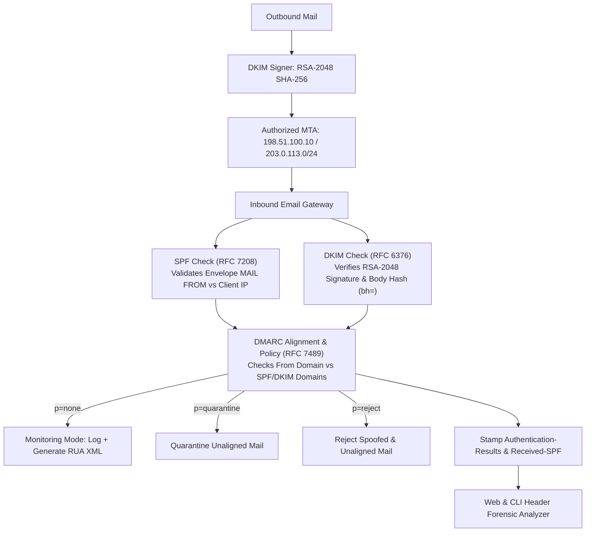

# EmailAuth - a Secure Email Authentication Gateway with SPF, DKIM, and DMARC1

A complete, standards-compliant **EmailAuth - a Secure Email Authentication Gateway with SPF, DKIM, and DMARC1**, **Raw Header Forensic Analyzer (Web UI + CLI)**, and **Controlled Authoritative DNS Zone Environment** implementing **SPF (RFC 7208)**, **DKIM (RFC 6376)**, **DMARC (RFC 7489)**, and **Authentication-Results (RFC 8601)**.

---

## 1. Layered Defense Architecture

Email authentication combines three complementary protocols to stop domain spoofing, man-in-the-middle tampering, and phishing:



| Protocol | What It Protects | Limitation Alone | Role in Layered Defense |
| :--- | :--- | :--- | :--- |
| **SPF (RFC 7208)** | Authorizes sending IPv4/IPv6 addresses for `MAIL FROM` | Breaks on forwarding; does not verify header `From:` | Prevents unauthorized servers from sending as your envelope domain |
| **DKIM (RFC 6376)** | Cryptographically signs headers (`From`, `Subject`, etc.) and body hash | Does not dictate what to do when a signature is missing | Survives forwarding and detects header/body tampering |
| **DMARC (RFC 7489)** | Requires **identifier alignment** between `From:` and SPF/DKIM + enforces policy | Relies on SPF and DKIM signals | Closes the `From:` vs `MAIL FROM` gap and enforces `none` → `quarantine` → `reject` |

---

## 2. Configured DNS Records & Cryptographic Keys

Provisioned for controlled domain **`securemail.example`** (exported to `config/dns_zones.json` and BIND format `config/securemail.example.zone`):

1. **SPF Record (`securemail.example` TXT)**:
   ```text
   v=spf1 ip4:198.51.100.10 ip4:203.0.113.0/24 ip6:2001:db8:cafe::/48 -all
   ```
   Authorizes the primary gateway (`198.51.100.10`), outbound CIDR block (`203.0.113.0/24`), and IPv6 block (`2001:db8:cafe::/48`), with a strict hard-fail (`-all`) for all other senders.

2. **DKIM Key Pair & DNS Record (`selector1._domainkey.securemail.example` TXT)**:
   - RSA-2048 private key (`keys/selector1.private.pem`) & X.509 SPKI public key (`keys/selector1.public.pem`) generated via `src/crypto_rsa.py`.
   - Published as `v=DKIM1; k=rsa; h=sha256; p=<base64-SPKI>`.

3. **DMARC Rollout Lifecycle (`_dmarc.securemail.example` TXT)**:
   - **Phase 1 — Monitoring (`p=none`)**:
     ```text
     v=DMARC1; p=none; adkim=r; aspf=r; pct=100; sp=none; rua=mailto:dmarc-reports@securemail.example; ruf=mailto:dmarc-forensic@securemail.example; fo=1
     ```
     Collects alignment telemetry (`100%` pass rate across 3 legitimate aligned messages) and generates RFC 7489 XML aggregate report `reports/dmarc_aggregate_report.xml`.
   - **Phase 2 — Quarantine (`p=quarantine`)**: Promotes after alignment validation.
   - **Phase 3 — Enforcement (`p=reject`)**:
     ```text
     v=DMARC1; p=reject; adkim=s; aspf=s; pct=100; sp=reject; rua=mailto:dmarc-reports@securemail.example; ruf=mailto:dmarc-forensic@securemail.example; fo=1
     ```

---

## 3. Project Structure

```text
email_auth_gateway/
├── cli.py                       # CLI tool: setup, sign, analyze, promote, demo
├── web_app.py                   # FastAPI Web UI & REST API for raw header analysis
├── requirements.txt             # Dependencies (FastAPI, Uvicorn, Pydantic, pytest)
├── config/
│   ├── dns_zones.json           # Controlled authoritative DNS TXT/A/MX store
│   └── securemail.example.zone  # RFC 1035 BIND zone export
├── keys/
│   ├── selector1.private.pem    # RSA-2048 PKCS#1 private signing key
│   └── selector1.public.pem     # RSA-2048 X.509 SPKI public key
├── samples/
│   ├── 01_legitimate_aligned.eml
│   ├── 02_spoofed_unauthorized_ip.eml
│   ├── 03_tampered_dkim_body.eml
│   └── 04_unaligned_phishing_relay.eml
├── reports/
│   ├── dmarc_aggregate_report.xml
│   └── gateway_verification_report.json
├── src/
│   ├── config.py                # Domain, selector, IPs, and path settings
│   ├── crypto_rsa.py            # Pure-Python RFC 8017 RSA-2048 & ASN.1 DER/PEM
│   ├── dns_store.py             # Controlled DNS zone store + BIND export + UDP fallback
│   ├── spf.py                   # RFC 7208 SPF evaluator (CIDR, include, 10-lookup cap)
│   ├── dkim.py                  # RFC 6376 DKIM signer & verifier (relaxed/simple)
│   ├── dmarc.py                 # RFC 7489 DMARC alignment, lifecycle & RUA XML reports
│   ├── header_parser.py         # Raw email/header parser & spoofing risk analyzer
│   └── gateway.py               # Inbound/outbound SecureEmailGateway orchestrator
└── tests/
    └── test_gateway.py          # Automated pytest suite (6 tests)
```

---

## 4. Usage Guide (CLI & Web Tool)

### Run the End-to-End Controlled Simulation
```bash
python -m email_auth_gateway.cli demo
```

### Analyze Any Raw Email or Header File via CLI
```bash
python -m email_auth_gateway.cli analyze --input email_auth_gateway/samples/01_legitimate_aligned.eml
python -m email_auth_gateway.cli analyze --input email_auth_gateway/samples/04_unaligned_phishing_relay.eml --json
```

### Launch the Web-Based Header Analyzer & Policy Console
From inside `email_auth_gateway/`:
```bash
uvicorn web_app:app --reload --port 8000
```
Or from the repository root (`aicodequesttask/`):
```bash
uvicorn email_auth_gateway.web_app:app --reload --port 8000
```
Open `http://127.0.0.1:8000` to:
- Paste raw RFC 5322 emails or headers (or load the 4 built-in attack/legitimate samples) and inspect parsed SPF, DKIM, DMARC alignment, hop chains, and spoofing risk scores.
- Dynamically generate and sign outgoing test emails (`POST /api/sign`).
- Inspect the live BIND DNS zone (`GET /api/dns`) and transition DMARC policies (`p=none` → `p=quarantine` → `p=reject`).

---

## 5. Verified Simulation & Test Results

### Controlled Gateway Scenarios (Under Enforced `p=reject; adkim=s; aspf=s`)

| Scenario | Sample File | SPF | DKIM | DMARC | Disposition | Analyzer Verdict | Risk Score |
| :--- | :--- | :---: | :---: | :---: | :---: | :---: | :---: |
| **Legitimate Signed & Aligned** | `01_legitimate_aligned.eml` | `pass` | `pass` | `pass` | `accept` | `TRUSTED` | `0 / 100` |
| **Spoofed Unauthorized IP** | `02_spoofed_unauthorized_ip.eml` | `fail` | `none` | `fail` | `reject` | `MALICIOUS_OR_SPOOFED` | `80 / 100` |
| **Tampered Message Body** | `03_tampered_dkim_body.eml` | `fail` | `fail` | `fail` | `reject` | `MALICIOUS_OR_SPOOFED` | `100 / 100` |
| **Unaligned Phishing Relay** | `04_unaligned_phishing_relay.eml` | `pass` | `none` | `fail` | `reject` | `MALICIOUS_OR_SPOOFED` | `95 / 100` |

### Automated Test Suite
```bash
python -m pytest email_auth_gateway/tests/test_gateway.py -v
```
All **6 test suites** pass (`test_rsa_2048_keygen_serialization_and_signing`, `test_spf_mechanisms_and_lookup_limit`, `test_dkim_sign_verify_and_tamper_detection`, `test_dmarc_alignment_and_monitoring_to_reject_lifecycle`, `test_header_analyzer_detects_spoofing_and_parses_headers`, `test_cli_demo_and_web_api_endpoints`).
